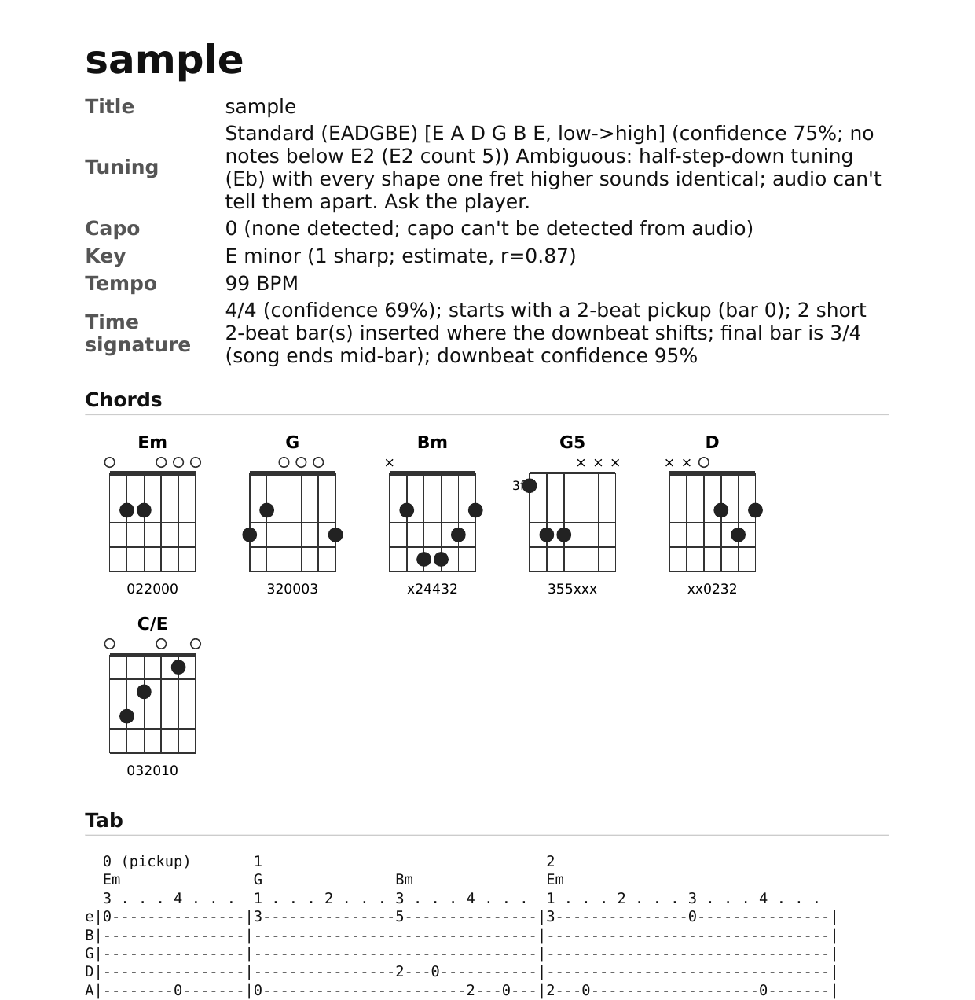
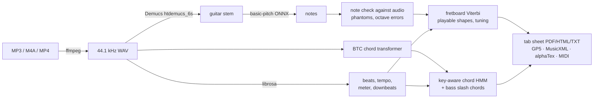

<div align="center">

# 🎸 audio2tab

**Turn any song into guitar tab: tuning, chords, key, tempo and time signature, in one command.**

Give it an MP3, M4A or MP4. You get back a printable tab sheet with chord diagrams, plus Guitar Pro, MusicXML and MIDI files.
It runs on CPU, offline after the first run, and is MIT licensed.

[](https://github.com/wixregiga/audio2tab/actions/workflows/docker.yml)
[](https://github.com/wixregiga/audio2tab/pkgs/container/audio2tab)
[](LICENSE)
[](pyproject.toml)



<sub>Real output on a synthetic band mix (guitar, bass, drums, lead), rendered from <code>sample.tab.pdf</code>.</sub>

</div>

---

## ✨ Features

| You get | Where it appears |
|---|---|
| **Guitar tab** (6-line, bar numbers, beat count, 16th grid, pickup bars) | `.tab.pdf`, `.tab.html`, `.tab.txt` |
| **Tuning** (Standard, Drop D, half-step down, D standard, Drop C#/C) with confidence, plus capo | sheet header, all exports |
| **Chords** from a transformer model, key-aware, up to 2 per bar, with slash chords (`C#/F`) and power chords | above the tab, plus a **chord diagram chart** |
| **Key**, **tempo** (handles drift) and **time signature** (4/4 vs 3/4, downbeats, short bars) | sheet header, GP5/MusicXML/MIDI metadata |
| **Playable fingerings**: at most 4 fingers and a 4-fret span, low hand movement | tab, `.gp5`, `.musicxml` (TAB staff) |
| Editable files | `.gp5` (Guitar Pro / TuxGuitar), `.musicxml` (MuseScore), `.alphatex`, `.mid` |
| Isolated guitar and a full report | `.guitar.wav`, `.summary.md`, `.summary.json` |

## 🚀 Quick start

### Docker (recommended)

```bash
docker pull ghcr.io/wixregiga/audio2tab:latest

# Linux / macOS: put song.mp3 in the current folder
docker run --rm -v "$PWD":/data -v audio2tab-cache:/cache \
  ghcr.io/wixregiga/audio2tab song.mp3 --out out/song
```

```powershell
# Windows PowerShell
docker run --rm -v "${PWD}:/data" -v audio2tab-cache:/cache `
  ghcr.io/wixregiga/audio2tab song.mp3 --out out/song
```

Outputs land in `./out/song/` on your machine: `song.tab.pdf`, `song.gp5`, `song.musicxml` and the rest.

- **`/data`** is the working directory. Mount the folder that holds your audio there; relative paths in the command resolve against it.
- **`/cache`** is a named volume. On the first run with separation, Demucs `htdemucs_6s` (~53 MB) downloads into it, together with the numba JIT cache. Later runs are offline and about 2x faster. The BTC chord weights (12 MB) and the basic-pitch ONNX model are already in the image.
- On Linux the container runs as UID 1000. If your user ID is different, add `--user "$(id -u):$(id -g)"`.

### Local (Python 3.11)

```bash
git clone https://github.com/wixregiga/audio2tab && cd audio2tab
python3.11 -m venv .venv && . .venv/bin/activate
pip install --index-url https://download.pytorch.org/whl/cpu torch torchaudio
pip install -e .
pip uninstall -y tensorflow || true      # basic-pitch must use its ONNX model
# system: ffmpeg + Pango (apt install ffmpeg libpango-1.0-0 libpangoft2-1.0-0 / brew install ffmpeg pango)
./run.sh song.m4a --out out/song
```

### Options you'll actually use

```text
--no-separate          clean solo-guitar recording: skip Demucs (much faster)
--tuning DADGBE        force a tuning (default: auto-detect); also 'D2 A2 D3 G3 B3 E4'
--capo 2               capo position (can't be heard in audio)
--start 30 --end 90    only transcribe part of the file (seconds)
--bpm 120              tempo hint if it comes out double/half
--beats-per-bar 3      force 3/4 (default: auto 4/4 vs 3/4)
--chords model|chroma  chord detector (default: model; falls back to chroma automatically)
--subdivision 2        8th-note grid (cleaner for strummed songs)
--title "My Song"      sheet title
```

Run `audio2tab --help` (or `docker run --rm ghcr.io/wixregiga/audio2tab --help`) for everything else.

### Build the image yourself

```bash
docker build -t audio2tab .                              # ~1.7 GB, CPU-only
docker build --build-arg BAKE_DEMUCS=1 -t audio2tab .    # +53 MB, works fully offline
```

## 🧠 How it works



Each stage is described in detail in [docs/HOW_IT_WORKS.md](docs/HOW_IT_WORKS.md).

## 📊 Accuracy (honest numbers)

All numbers are measured with [mir_eval](https://github.com/craffel/mir_eval) on **synthetic** songs where the ground truth is known exactly. Real recordings are harder.

| Benchmark | Result |
|---|---|
| Notes, clean guitar (onset + pitch F1) | **0.84** |
| Notes, full band mix (onset + pitch F1) | 0.65 |
| Chords, full mix, whole pipeline (major/minor WCSR, 10 songs) | **86.0%** (v3 chroma method: 56.5%) |
| Chords, guitar only, whole pipeline | 70.2% (v3: 67.2%); beat-tracking misses on 2 of the 10 songs pull this down |
| Chord detector alone on true boundaries (30 songs, mix / guitar) | 98.3% / 99.8% |
| Cost of the chord model | about 1 s and about 100 MB RAM per 3-minute song |

Reproduce with `python -m tests.chord_bench 10` and `python tests/eval_e2e.py all`.

**Limitations**
- Rhythm is quantized to a 16th grid. Swing, triplets and rubato come out approximate, and 6/8 isn't detected.
- No bends, slides, hammer-ons, pull-offs or palm mutes.
- Dense strums lose inner notes, distortion adds false harmonics, and two guitars are merged into one part.
- Chords are major/minor triads, power chords and slash chords only (no 7ths, sus or extended chords yet).
- A capo can't be heard. Tunings below standard are detected only when low notes are actually played.

## 🗺️ Roadmap

- [ ] Extended chord vocabulary (7, maj7, sus, dim) using BTC's 170-class model
- [ ] Bend, slide and hammer-on/pull-off detection
- [ ] 6/8 and compound meters
- [ ] Multiple guitar parts (rhythm and lead)
- [ ] Web UI (drag-and-drop to PDF)
- [ ] GPU image variant

Ideas welcome in [Discussions](https://github.com/wixregiga/audio2tab/discussions).

## 🤝 Contributing

PRs welcome! See [CONTRIBUTING.md](CONTRIBUTING.md) for setup, tests and the benchmarks to run, and please follow the [Code of Conduct](CODE_OF_CONDUCT.md). Security issues: see [SECURITY.md](SECURITY.md).

## 🙏 Acknowledgements

audio2tab is built on these projects:

| Project | Used for | License |
|---|---|---|
| [Demucs](https://github.com/facebookresearch/demucs) (Meta AI) | guitar/bass source separation | MIT |
| [basic-pitch](https://github.com/spotify/basic-pitch) (Spotify) | polyphonic note transcription | Apache-2.0 |
| [BTC-ISMIR19](https://github.com/jayg996/BTC-ISMIR19) (Park et al., 2019) | chord recognition (model code vendored in `audio2tab/btc/`) | MIT |
| [librosa](https://github.com/librosa/librosa) | beats, CQT/chroma, onsets | ISC |
| [mir_eval](https://github.com/craffel/mir_eval) | evaluation | MIT |
| [PyGuitarPro](https://github.com/Perlence/PyGuitarPro), [music21](https://github.com/cuthbertLab/music21), [pretty_midi](https://github.com/craffel/pretty-midi) | GP5, MusicXML, MIDI export | LGPL-3.0, BSD-3, MIT |
| [WeasyPrint](https://github.com/Kozea/WeasyPrint) | PDF rendering | BSD-3 |
| [FFmpeg](https://ffmpeg.org) | decoding; the Docker image ships John Van Sickle's static build | GPL-3.0 (binary only, not linked) |

## License

[MIT](LICENSE) © 2026 Brandon Clarke. Third-party components keep their own licenses (listed above).
